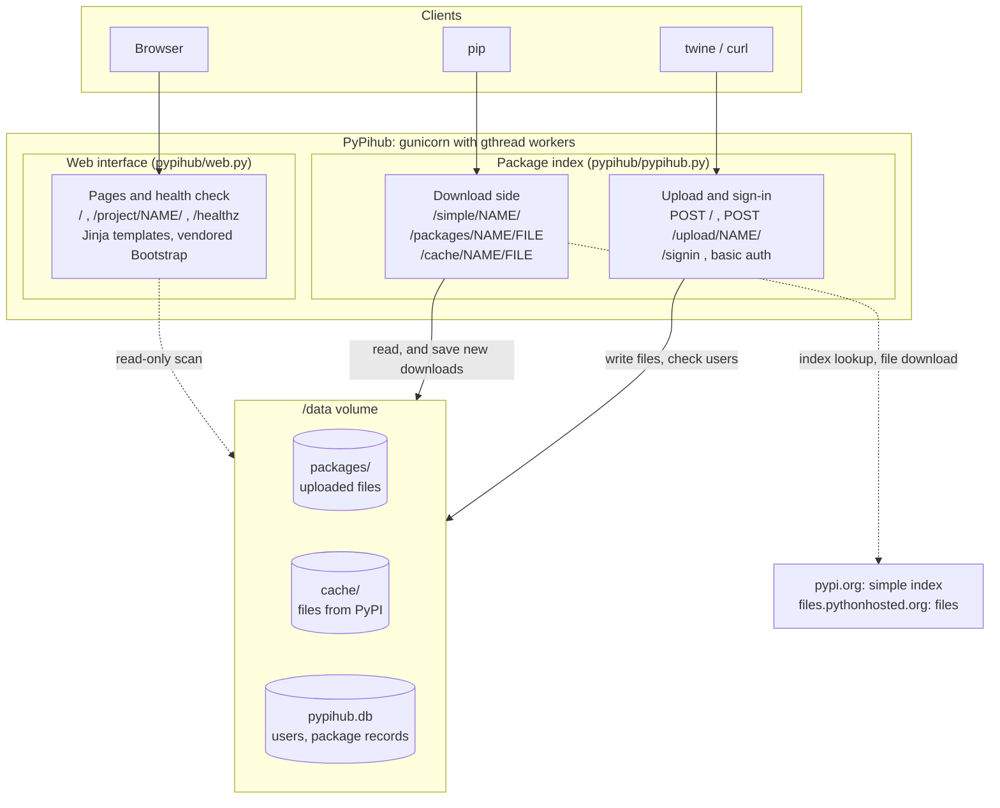
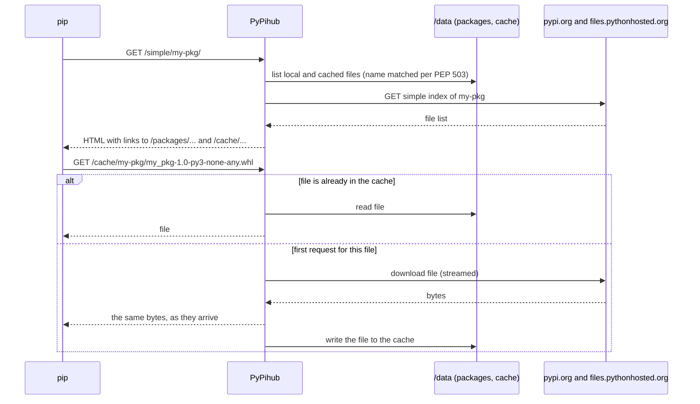
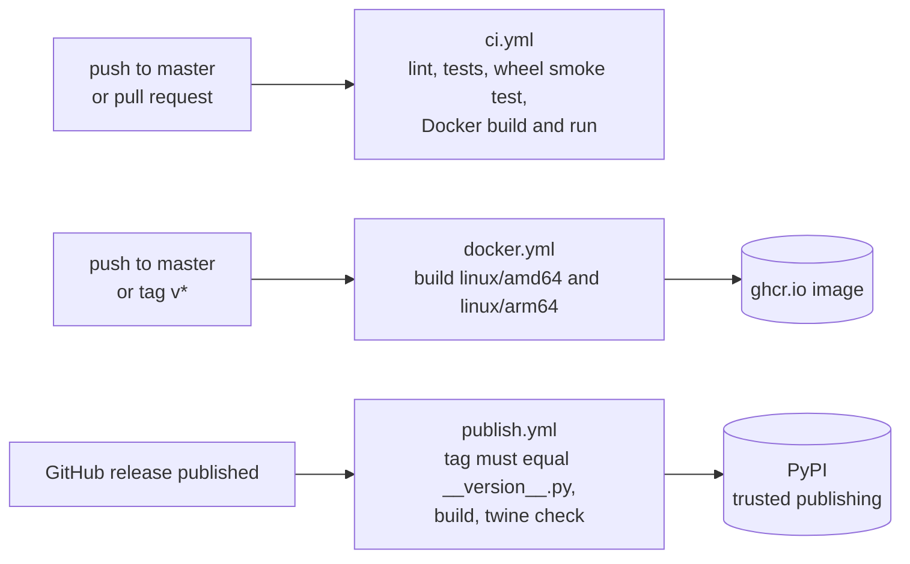

# PyPihub - Local PyPI Server

PyPihub is a simple local PyPI server with caching and package upload capabilities. This server allows you to host your Python packages locally, cache packages from the official PyPI, and supports package uploads via `twine`.

This version uses Flask. If you install via pip, use: `pip install pypihub[flask]`

When installing with pip, PyPihub will not interrupt the download or installation process. If the requested package is not found in the `cache` or `package` directory, PyPihub will fetch it directly from pypi.org and simultaneously serve it to the client. This means the client does not have to wait for the server to finish downloading before receiving the package. All downloaded packages from pypi.org will also be saved to the cache for future use.

## Key Features

- **Multi-platform**: Supports any platform (Linux, Windows, Mac, etc.)
- **Local Package Hosting**: Host your own Python packages locally
- **PyPI Caching**: Automatic caching of packages from official PyPI for faster access
- **Twine Support**: Upload packages using `twine` with authentication
- **Web Interface**: Simple web interface for browsing packages
- **Flexible Configuration**: Configuration via INI files, environment variables, or command arguments

## Architecture

### Components



[](https://i.ibb.co/nMmXnfLS/architecture1.jpg)

The web interface only reads the two package directories, so it never changes how pip and twine talk to the server.

### What happens on `pip install`



[](https://i.ibb.co/zTgqyw1b/pypihub-architecture2.jpg)

Files you uploaded are served from `/packages/...` straight from disk and never touch PyPI.

### Build and release pipeline



[](https://i.ibb.co/1G0HxgY4/pypihub-architecture3.jpg)

<p align="center">
  <a href="https://i.ibb.co/PZj0xJVv/pypihub-screenshot1.png" target="_blank">
    
  </a>
  <a href="https://i.ibb.co/mVVr09Cs/pypihub-screenshot2.png" target="_blank">
    
  </a>
</p>


## Installation

### Requirements

Python 3.10 or newer.

```bash
pip install -r requirements.txt
```

### Download and Setup

```bash
git clone <repository-url>
cd pypihub
```

Or you can install with pip:
```bash
$ pip install pypihub[flask]
```

## Configuration

### 1. Configuration File (pypihub.ini)

Create a `pypihub.ini` as an alternative config file, or it will be created automatically in the same directory as `pypihub.py`:

```ini
[dirs]
base = /path/to/base/directory
local_pkg = /path/to/local/packages
cache = /path/to/cache

[urls]
pypi_simple = https://pypi.org/simple

[server]
host = 0.0.0.0
port = 5000

[auths]
users = pypihub,pypihub;user2,pass2
```

### 2. Settings File (settings.py)

Alternatively, create a `settings.py` file (see example below):

```python
BASE_DIR = "/path/to/base"
LOCAL_PKG_DIR = "/path/to/packages"
CACHE_DIR = "/path/to/cache"
PYPI_SIMPLE_URL = "https://pypi.org/simple"
HOST = "0.0.0.0"
PORT = 5000
AUTHS = [("pypihub", "pypihub"), ("user2", "pass2")]
CONFIGFILE = "pypihub.ini"
```

### 3. Environment Variables

```bash
export BASE_DIR="/path/to/base"
export LOCAL_PKG_DIR="/path/to/packages"
export CACHE_DIR="/path/to/cache"
export PYPI_SIMPLE_URL="https://pypi.org/simple"
export HOST="0.0.0.0"
export PORT="5000"
export CONFIGFILE="pypihub.ini"
```

## Usage

### Running the Server

```bash
# Using default settings
python pypihub serve

# With custom configuration
# Option: '-c /path/to/config.ini'
python pypihub -c /path/to/config.ini -H 127.0.0.1 -P 8080

# Verbose mode
python pypihub -v

# Show help
python pypihub -h
```

### Command Line Arguments

```
-c, --config          Path to configuration file
-b, --base-dir        Base directory for server
-l, --local-pkg-dir   Directory for local packages
-C, --cache-dir       Directory for cached packages
-p, --pypi-simple-url PyPI simple index URL
-H, --host            Host to run server on
-P, --port            Port to run server on
-V, --version         Show PyPihub version
-v, --verbose         Enable verbose output
```

## Package Upload

### Using Twine

1. **Configure ~/.pypirc**:

```ini
[distutils]
index-servers = pypihub

[pypihub]
repository = http://localhost:5000/
username = pypihub
password = pypihub
```

2. **Upload package**:

```bash
# Build package first
python setup.py sdist bdist_wheel

# Upload to pypihub
twine upload --repository pypihub dist/*
```

### Manual Upload via HTTP

```bash
curl -X POST \
  -u pypihub:pypihub \
  -F "file=@package-1.0.0-py3-none-any.whl" \
  http://localhost:5000/upload/package-name/
```

## Installing Packages from PyPihub

### Configure pip

Add to `~/.pip/pip.conf` (Linux/Mac) or `%APPDATA%\pip\pip.ini` (Windows):

```ini
[global]
extra-index-url = http://localhost:5000/simple/
trusted-host = localhost
```

### Install Package

```bash
# Install from pypihub (with fallback to PyPI)
pip install package-name

# Install only from pypihub
pip install --index-url http://localhost:5000/simple/ package-name

# Install with extra index
pip install --extra-index-url http://localhost:5000/simple/ package-name
```

## Web Interface

Open the server address in a browser. The interface follows the system light or dark setting and has a
theme switch in the header (System, Light, Dark; the choice is remembered). Press `/` to jump to the search box.
Typing a name that is not stored yet shows the exact `pip install` command, because installing it through
PyPihub fetches it from PyPI and caches it.

It is built on Bootstrap 5.3 with self-hosted fonts and icons, all vendored under `pypihub/static`
(see `pypihub/static/vendor/README.md`), so it works on a network without internet access.

| Variable | Purpose |
|---|---|
| `PYPIHUB_UI_CACHE_TTL` | Seconds a directory scan is reused by the interface (default `5`, `0` disables) |
| `PYPIHUB_TRUST_PROXY` | Set to `1` behind a reverse proxy so links use `X-Forwarded-Proto`, `X-Forwarded-Host` and `X-Forwarded-Prefix` |
| `SECRET_KEY` | Signs sign-in cookies. Without it a random key is generated for each process |

## Docker

```bash
cp .env.example .env        # set PYPIHUB_ADMIN_USER and PYPIHUB_ADMIN_PASSWORD
docker compose up -d
```

Or without compose:

```bash
docker run -d --name pypihub -p 5000:5000 -v pypihub-data:/data \
  -e PYPIHUB_ADMIN_USER=admin -e PYPIHUB_ADMIN_PASSWORD='change-me' \
  ghcr.io/cumulus13/pypihub_flask:latest
```

- Everything is stored in `/data` (uploaded packages, PyPI cache, user database, config). The container runs as UID 10001;
  for a bind mount run `chown -R 10001:10001 <host directory>` first.
- The account in `PYPIHUB_ADMIN_USER` is created, or has its password reset, each time the container starts.
  Use `PYPIHUB_ADMIN_PASSWORD_FILE` to read the password from a Docker secret. Add more users with
  `docker exec -it pypihub pypihub user -u NAME`.
- Without `SECRET_KEY` a key is generated once and kept in the volume.
- Served by gunicorn (`WEB_CONCURRENCY` workers, `GUNICORN_THREADS` threads each). Images for `linux/amd64` and
  `linux/arm64` are published to GHCR: `:edge` from `master`, `:X.Y.Z`, `:X.Y` and `:latest` from release tags.

## Development, Tests and CI

```bash
pip install -r requirements-dev.txt
pytest
```

GitHub Actions: `ci.yml` (lint, tests on Python 3.10 to 3.13 and Windows, wheel build and smoke test, Docker build and run),
`docker.yml` (publish the image to GHCR) and `publish.yml` (publish a GitHub release to PyPI through trusted publishing).

## API Endpoints

### Web Interface
- `GET /` - Package browser: search, filter by local/cached, sort, copy-ready pip and twine commands
- `GET /project/<name>/` - Files of one package with download links
- `GET /healthz` - JSON health check (used by the Docker `HEALTHCHECK`)

### Package Management
- `POST /upload/<package>/` - Upload package (with auth)
- `POST /upload/` - Upload package via twine (with auth)
- `GET /packages/<package>/<filename>` - Serve local package files
- `GET /cache/<package>/<filename>` - Serve cached package files

### Package Index
- `GET /simple/<package>/` - Simple index for specific package

## Directory Structure

Source tree:

```
.
├── pypihub/
│   ├── pypihub.py          # Package index, upload and authentication (Flask app)
│   ├── web.py              # Web interface blueprint: /, /project/NAME/, /healthz
│   ├── database.py         # SQLAlchemy models (users, packages)
│   ├── logger.py           # Logging setup
│   ├── settings.py         # Settings file (optional)
│   ├── pypihub.ini         # Configuration file (optional)
│   ├── templates/          # Jinja templates for the web interface
│   └── static/             # CSS, JS, fonts, icons (Bootstrap vendored, see vendor/README.md)
├── tests/                  # pytest suite
├── docker/entrypoint.sh    # Container entrypoint
├── Dockerfile
├── docker-compose.yml
└── .github/workflows/      # ci.yml, docker.yml, publish.yml
```

Data directories (the `/data` volume in Docker):

```
packages/                   # Uploaded packages
└── package-name/
    ├── package-1.0.0.tar.gz
    └── package-1.0.0-py3-none-any.whl
cache/                      # Files fetched from PyPI
└── requests/
    └── requests-2.28.1-py3-none-any.whl
pypihub.db                  # Users and package records (SQLite by default)
```

## Authentication

Default credentials:
- Username: `pypihub`
- Password: `pypihub`

`Change the default credentials before using in production.`

To change credentials, edit configuration in `settings.py`, `pypihub.ini`, or environment variables.

example 'pypihub.ini' for authentication

```ini
[auths]
users = userame password
```

## Logging

PyPihub uses custom logging with levels:
- EMERGENCY
- CRITICAL
- ERROR
- WARNING
- NOTICE
- INFO
- DEBUG

Set `verbose` mode with `-v` for debug logging.

## Troubleshooting

### Package not found
- Ensure package exists in local directory or is available on PyPI
- Check `PYPI_SIMPLE_URL` configuration

### Upload failed
- Check authentication credentials
- Ensure `LOCAL_PKG_DIR` directory is writable
- Check if file already exists (409 error)

### Cache not working
- Ensure `CACHE_DIR` directory is writable
- Check internet connection for downloading from PyPI

### Port already in use
- Change port with `-P` parameter or configuration
- Check processes using port: `lsof -i :5000`

## Development

### Dependencies
- Flask - Web framework
- BeautifulSoup4 - HTML parsing
- Requests - HTTP client
- Rich - Console output formatting
- ConfigSet - Configuration management
- PyDebugger - Debug utilities

### Contributing
1. Fork repository
2. Create feature branch
3. Commit changes
4. Push to branch
5. Create Pull Request
6. Describe your changes in the Pull Request.

## License

PyPihub is released under the [GNU Lesser General Public License v3.0 (LGPL-3.0)](https://www.gnu.org/licenses/lgpl-3.0.html).

You should have received a copy of the GNU Lesser General Public License along with this program.  
If not, see [https://www.gnu.org/licenses/](https://www.gnu.org/licenses/).

For commercial licensing options, please contact: [cumulus13@gmail.com](mailto:cumulus13@gmail.com)

## Support

For issues and questions, please create/open an issue in the repository or contact [cumulus13@gmail.com](mailto:cumulus13@gmail.com).

---

**PyPihub** - Simplifying local Python package management

`Warning: Do not expose this server to the public internet without proper authentication and security measures.`

## Author
[Hadi Cahyadi](mailto:cumulus13@gmail.com)
    
[](https://www.buymeacoffee.com/cumulus13)

[](https://ko-fi.com/cumulus13)

[Support me on Patreon](https://www.patreon.com/cumulus13)
